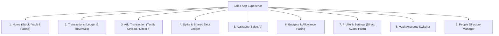

# Saldo — Design System & Interface Architecture ("Stealth Luxury")

> Comprehensive design specification, visual tokens, layout contracts, and screen-by-screen interface breakdown for the Saldo mobile application.

---

## 1. Executive Design Philosophy: "Stealth Luxury"

Saldo rejects the prevailing conventions of contemporary consumer finance apps: candy-colored gamification, neon gradients, bloated credit-score upselling cards, and cookie-cutter 3-card templates ("AI slop").

Instead, Saldo is built upon the **Stealth Luxury** design philosophy:
- **Monochrome & Dark-Mode-First:** Built from an ink-and-carbon palette (`#090D16`, `#0D111A`, `#161B26`, `#1C1C1F`). Visual hierarchy is achieved through contrast, tonal elevation, hairline borders (`1px` `#27272A` / `#E4E7EC`), and typography weight, rather than color distraction.
- **The Golden Accent Principle (`#C9A24B`) & Overdue Hierarchy:** Gold is **strictly reserved for overdue debt obligations** (where `due_date < today` or urgent settlement calls). It is forbidden from being used for decoration, general primary buttons, active tab indicators, or arbitrary highlights. Casual un-due debts receive subtle, stealth slate badges (`#161B26` / `#94A3B8`). This prevents the **"Gold Wall"** anti-pattern (where a user with ten open casual tabs is bombarded with loud gold alerts). When a user sees gold, it communicates one exact message: *an overdue financial debt requires urgent attention*.
- **The Electric Catalyst Accent (`#D4F938`):** An intense, acid-lime green reserved solely for the central floating `+` action catalyst. It acts as an unmistakable call-to-action to capture expenses in under three seconds.
- **Tactile Micro-Interactions:** Micro-spring physical feedback (`active:scale-95`, `active:scale-98`) gives buttons, keypad cells, and chips the weight of physical bank terminal hardware.
- **Strict Touch Geometry:** Every interactive element satisfies the WCAG $44 \times 44\text{px}$ minimum bounding box with expanded `hitSlop` safety margins.

---

## 2. Design Tokens & Visual Hierarchy

### 2.1 Color Token Matrix

| Token Name | Hex Code | Tailwind Equivalent | Semantic Role & Strict Rules |
| :--- | :--- | :--- | :--- |
| **Canvas Dark** | `#090D16` | `bg-[#090D16]` | Base screen background in dark mode. Pure obsidian tone. |
| **Surface Dark** | `#0D111A` | `bg-[#0D111A]` | Cards, containers, and elevated panels. |
| **Surface Card** | `#161B26` | `bg-[#161B26]` | Secondary grouped cards and modal layers. |
| **Surface Elevated** | `#1C1C1F` | `bg-[#1C1C1F]` | Elevated utility bars, buttons, and input fields. |
| **Hairline Border Dark** | `#27272A` | `border-zinc-800` | Crisp structural separation between list items and cards. |
| **Text Primary Dark** | `#FFFFFF` | `text-white` | Hero numbers, primary headings, active labels. |
| **Text Secondary Dark**| `#94A3B8` | `text-slate-400` | Subtitles, section headers, metadata chips. |
| **Text Muted Dark** | `#64748B` | `text-slate-500` | Timestamps, inactive hints, empty state explanations. |
| **Overdue Debt Gold**   | `#C9A24B` | `text-[#C9A24B]` / `bg-[#C9A24B]` | **RESERVED:** Overdue debts, past-due splits, urgent settlement calls. |
| **Gold Ghost Tint**    | `rgba(201, 162, 75, 0.12)` | `bg-[#C9A24B]/10` | Badges and background chips strictly for overdue obligations. |
| **Open Debt Slate**    | `#94A3B8` / `#161B26` | `text-slate-400 bg-slate-800` | Subtle stealth chips for active non-overdue debts (anti-Gold Wall). |
| **Catalyst Acid Lime** | `#D4F938` | `bg-[#D4F938]` | Raised center `+` button in bottom tab bar. |
| **Success Emerald** | `#10B981` | `text-emerald-500` | Inflows, deposits, and completed settlement badges. |
| **Destructive Coral** | `#EF4444` | `text-red-500` | Delete account actions, transaction reversals, warnings. |

---

### 2.2 Typography System

Saldo pairs **IBM Plex Sans** (editorial headers, monumental currency digits, and metric cards) with **Roboto** (ultra-legible tabular figures, dense financial feeds, and metadata):

```
Display Large   : 36px / Weight: 900 (Black)   / Line-Height: 40px / Tracking: -0.03em  (Monumental Balance)
Display Medium  : 28px / Weight: 800 (Extrabold)/ Line-Height: 34px / Tracking: -0.02em  (Hero Amounts)
Heading 1       : 22px / Weight: 700 (Bold)     / Line-Height: 28px / Tracking: -0.01em  (Screen Titles)
Heading 2       : 18px / Weight: 700 (Bold)     / Line-Height: 24px / Tracking: 0.0em   (Card Titles)
Body Regular    : 14px / Weight: 400 (Regular)  / Line-Height: 20px / Tracking: 0.0em   (Feed Item Details)
Body Strong     : 14px / Weight: 600 (Semibold) / Line-Height: 20px / Tracking: 0.0em   (Row Labels)
Caption Dense   : 12px / Weight: 500 (Medium)   / Line-Height: 16px / Tracking: 0.01em  (Timestamps, Category Tags)
Overline Micro  : 11px / Weight: 700 (Bold)     / Line-Height: 14px / Tracking: 0.06em  (UPPERCASE SECTION HEADERS)
```

---

### 2.3 Geometry, Radius & Elevation

- **Full Pill (`rounded-full` / `9999px`):** Used for filter chips, avatar badges, status indicators, and modal drag handles.
- **Monumental Container (`rounded-3xl` / `24px`):** Used for top hero balance cards, net obligation banners, and bottom sheet dialogs.
- **Card Container (`rounded-2xl` / `16px`):** Used for feed rows, tactile keypad buttons, group items, and input textboxes.
- **Interactive Button (`rounded-xl` / `12px`):** Used for compact action buttons and calculator operators (`+`, `-`, `×`, `÷`).

---

## 3. Screen-by-Screen Interface Architecture

Saldo features **9 primary visual viewports** engineered for high-density information architecture.



---

### Screen 1: Home — Studio Vault & Dashboard
*Location:* `app/(root)/(tabs)/index.tsx` & `src/features/home/`

```
┌────────────────────────────────────────────────────────┐
│  [● 14 Apr 2026]                    [ ⊞ Tools ] [(SK)] │ ← Date Pill, Drawer Toggle & Direct Avatar
├────────────────────────────────────────────────────────┤
│  ▼ ANIMATED PUSH-DOWN FEATURE DRAWER                   │
│  [Accounts]    [Budgets]    [Categories]    [Recurring]│ ← Non-Tab Shortcuts Only (4 Items)
├────────────────────────────────────────────────────────┤
│  AVAILABLE BALANCE                     [ 👁 Eye Toggle ]│ ← Eye Toggle ("••••••")
│                                                        │
│  ₨ 1,248,500.00                                        │ ← Monumental Display Balance (Dynamically scaled)
│  [All Accounts ▾]                                      │ ← Account Switcher Trigger
│                                                        │
│  [+ ₨ 180,000 Inflow]        [- ₨ 42,500 Outflow]      │ ← Cashflow Micro-Pills
└────────────────────────────────────────────────────────┘
│  SAFE DAILY BURN & PACING: ₨ 2,400 / day     [ 68% ]   │ ← Live Allowance Track
│                                                        │
│  RECENT ACTIVITY                         [ See All → ] │
│  ┌──────────────────────────────────────────────────┐  │
│  │ 🛒 Carrefour Grocery         Today      - ₨ 4,200│  │
│  │ 💼 Monthly Retainer Deposit  Yesterday + ₨ 95,000│  │
│  │ ☕ Blue Tokai Artisan Coffee Yesterday    - ₨ 850│  │
│  └──────────────────────────────────────────────────┘  │
└────────────────────────────────────────────────────────┘
```

#### What is on this screen:
1. **Top Utility Bar:**
   - **Date Badge:** Pill with green live-pulse dot and formatted date (*"14 Apr 2026"*).
   - **Quick Tools Drawer Toggle (`⊞`):** Push-down toggle for non-tab management shortcuts.
   - **User Initials Avatar:** Circular $40 \times 40\text{px}$ touch target displaying authenticated initials (e.g., `SK`). **Tapping directly navigates to Profile (`/(root)/Profile`)**.
2. **Animated Push-Down Feature Drawer (`HomeHeaderWithDrawer.tsx`):**
   - Streamlined to **non-tab destinations only**: *Accounts, Budgets, Categories, Recurring*. (Tabs like Splits and Assistant were removed to eliminate navigation redundancy).
3. **Studio Vault Balance Card:**
   - Plain language: displays **"Available Balance"** (scoped to active account) or **"Total Balance"** (aggregated net worth across all accounts).
   - **Balance Hide Toggle:** Eye icon button (`isBalanceHidden`) seamlessly toggles between numerical balance and masked `••••••` for privacy in public.
   - **Dynamic Font Scaling:** Uses `adjustsFontSizeToFit` and `numberOfLines={1}` so long amounts never wrap or overflow.
   - Inflow (emerald) and Outflow (rose) micro-pills summarize current-month liquidity flow.
   - Removed redundant 3-button add strip to maintain single primary entry point via center `+` tab button.
4. **Daily Spend Pace & Allowance Card:**
   - Cashew-style pacing indicator calculating safe daily burn rate based on remaining days in the cycle.
5. **Recent Activity Feed:**
   - Clean, grouped list of the 5 most recent transactions with high-contrast amounts and category icons.
   - Tapping an item opens the unified `TransactionDetailModal` with **"Post Reversal"** action.

---

### Screen 2: Transactions — Historical Ledger & Reversals
*Location:* `app/(root)/(tabs)/Transactions.tsx` & `src/features/transactions/`

```
┌────────────────────────────────────────────────────────┐
│  LEDGER & CASHFLOW                                     │
│  Audited ledger feed and historical trends             │
├────────────────────────────────────────────────────────┤
│  [ (All) ]  [ Income ]  [ Expenses ]  [ Transfers ]    │ ← Segmented Type Filter Chips
├────────────────────────────────────────────────────────┤
│  MONTHLY CASHFLOW VELOCITY                             │
│  Net: + ₨ 137,500.00                                   │
├────────────────────────────────────────────────────────┤
│  APRIL 2026 · THIS MONTH                               │
│  ┌──────────────────────────────────────────────────┐  │
│  │ ⚡ Electricity & Utilities   12 Apr     - ₨ 8,400│  │
│  │ 🍔 Friday Dinner Tab         10 Apr     - ₨ 3,100│  │
│  │ ↩ [Reversal] Friday Dinner   10 Apr     + ₨ 3,100│  │ ← Offsetting Reversal Counter-Entry
│  │ 💰 Investment Dividend       08 Apr    + ₨ 12,000│  │
│  └──────────────────────────────────────────────────┘  │
└────────────────────────────────────────────────────────┘
```

#### What is on this screen:
1. **Filter Header:**
   - Segmented filter chips (*All, Income, Expenses, Transfers*) plus expandable search bar to instantly isolate ledger entries.
2. **Unified Transaction Detail & Reversal Modal (`TransactionDetailModal.tsx`):**
   - **Double-Entry Append-Only Reversal:** Tapping *"Post Reversal"* generates an equal-and-opposite counter-entry (e.g. reversing an expense posts an income entry with `reason: 'reversal'`) and balance delta, while flagging the original entry as `cancelled`.
   - Explains ledger integrity: records are immutable and audit history is preserved.
3. **Grouped Transaction Feed:**
   - Transactions grouped by date with sticky hairline dividers.
   - Visual distinction: green `+` for deposits, stealth slate `-` for expenses, amber badge for reversals.

---

### Screen 3: Add Transaction — Tactile 3×4 Keypad & Fast Logging
*Location:* `app/(root)/(tabs)/AddTransactions.tsx`

```
┌────────────────────────────────────────────────────────┐
│  [ < Back ]          NEW RECORD           [ Save 44px] │
├────────────────────────────────────────────────────────┤
│     [ (Expense) ]     [ Income ]     [ Transfer ]      │ ← Type Switcher
├────────────────────────────────────────────────────────┤
│                                                        │
│  ₨ 1,200                                               │ ← Large Inline Math Display
│  "Lunch with team"                                     │ ← Note Input
│                                                        │
│  ★ You paid. Hamza owes you ₨ 600                      │ ← Live Debt Preview Banner
├────────────────────────────────────────────────────────┤
│  [🏷️ Dining ▾]  [💳 Bank ▾]  [📅 Today ▾]  [👥 Split ▾]│ ← Filter & Metadata Pills
├────────────────────────────────────────────────────────┤
│  [ + ]    [ - ]    [ × ]    [ ÷ ]    [ = ]             │ ← Arithmetic Operator Strip
├────────────────────────────────────────────────────────┤
│  [ 1 ]              [ 2 ]              [ 3 ]           │
│  [ 4 ]              [ 5 ]              [ 6 ]           │ ← Tactile 3×4 Physical Numpad
│  [ 7 ]              [ 8 ]              [ 9 ]           │
│  [ . ]              [ 0 ]              [ ⌫ ]           │
├────────────────────────────────────────────────────────┤
│  PRESETS:  [+100]    [+500]    [+1,000]    [+5,000]    │ ← Quick-Add Increment Chips
└────────────────────────────────────────────────────────┘
```

#### What is on this screen:
1. **Direct Catalyst Entry Point:**
   - Tapping the center `+` tab bar button routes directly to this tactile keypad in < 1 second (no intermediate modals or dead options).
2. **Monumental Amount Display with Inline Math:**
   - Allows inline calculations: typing `450 + 800 * 2` calculates with operator precedence.
3. **Deep Split & 1-on-1 Casual Debt Integration:**
   - **"Who Paid?" Selector:** Supports `You` vs `Friend` payer choices:
     - When you paid: records your expense and marks friend's portion as `owed_to_me`.
     - When friend paid: records your personal share as an expense and marks your debt to the friend as `i_owe`.
   - **1-on-1 Person Picker:** Split directly with an individual person without needing to create a dummy group.
   - **Deterministic Minor-Unit Math:** Integer division with remainder allocation ensures zero fractional loss down to the last paisa/cent.
4. **Tactile 3×4 Numpad:**
   - Hardware-styled buttons with `active:scale-95` micro-springs and quick-add preset chips (`+100`, `+500`, `+1,000`, `+5,000`).

---

### Screen 4: Splits — Shared Tabs, Groups & Informal Loans
*Location:* `app/(root)/(tabs)/Splits.tsx` & `src/features/splits/`

```
┌────────────────────────────────────────────────────────┐
│  SPLITS         [Manage Directory]  [+ Loan]  [+ Group]│ ← Direct Directory & Debt Controls
│  Shared tabs, direct loans & group debts               │
├────────────────────────────────────────────────────────┤
│  MONUMENTAL NET OBLIGATION CARD                        │
│  ┌──────────────────────────────────────────────────┐  │
│  │  NET DEBT POSITION                               │  │
│  │  + ₨ 4,200.00                                    │  │
│  │  ● YOU ARE OWED MONEY (3 Open Tabs)              │  │ ← Gold Dot ONLY if OVERDUE, else Slate
│  │                                                  │  │
│  │  Owed to You: ₨ 5,700       You Owe: ₨ 1,500     │  │
│  └──────────────────────────────────────────────────┘  │
├────────────────────────────────────────────────────────┤
│  VIEW SEGMENT SWITCHER                                 │
│  [ People (1) ]        [ Groups (2) ]     [ Ledger (3) ]│ ← 3-Way Segment Switcher
├────────────────────────────────────────────────────────┤
│  PEOPLE VIEW (Default — "Person as the Unit")          │
│  ┌──────────────────────────────────────────────────┐  │
│  │ (HK) Hamza K.                   OWES YOU ₨ 3,400 │  │ ← Aggregated net person card
│  │      2 active items (1 overdue)      [▲ Collapse]│  │ ← Gold badge strictly if overdue
│  │      ─────────────────────────────────────────── │  │
│  │      ↗ Apartment 4B Split (Split)   ₨ 2,400 [Settle]│ ← Expandable breakdown
│  │      ↗ Personal Loan (Loan)         ₨ 1,000 [Settle]│   Partial settlement enabled
│  └──────────────────────────────────────────────────┘  │
└────────────────────────────────────────────────────────┘
```

#### What is on this screen:
1. **Net Obligation Hero Card (`ObligationHeroCard.tsx`):**
   - Displays net position across all 1-on-1 direct loans and shared group splits.
   - Respects the anti-Gold-Wall hierarchy: displays the solid `#C9A24B` gold dot and badge only when overdue debts exist (`has_overdue`). Otherwise renders subtle stealth slate metrics (`#94A3B8`).
2. **Two Distinct Settlement Modes (`SettleModal.tsx`):**
   - **Mode A: Settle from Account (Ledger Movement):** Deducts or credits your designated bank or cash account via a double-entry `balance_entries` delta. Use this when money actually moved through your accounts.
   - **Mode B: Settle Off-Ledger (Mark Settled Only):** Closes the debt obligation record without executing balance movements. Ideal for physical cash handovers, external peer-to-peer repayments, or reciprocal barter.
   - **Partial Repayments:** Supports partial settlements (e.g. paying ₨ 2,000 towards ₨ 5,000) via 50%/100% quick chips or custom amounts, transitioning the debt to `partially_settled`.
3. **People Directory Manager (`PeopleManagerModal.tsx`):**
   - Accessible via the header `[Manage Directory]` button.
   - Allows users to rename contacts, inspect individual debts, and safely delete contacts (strictly guarded against deleting anyone with an open debt balance).
4. **Direct 1-on-1 Informal Loans Modal (`DirectLoanModal.tsx`):**
   - Direct capture of casual debts (*"I lent Ali 5,000"*, *"Cousin lent me 20,000"*) without creating or managing groups.
   - Direction toggle: *I Lent (Receivable)* vs. *I Borrowed (Liability)*.
   - Accounting double-entry safety: Recorded as `type: "lend"` or `"borrow"`. Balance is drawn/deposited via `balance_entries`, preserving income/expense budget calculations.
   - Optional due date field enables proactive overdue tracking.

---

### Screen 5: Budgets — Spending Limits & Pacing Architecture
*Location:* `app/(root)/budgets/index.tsx`, `app/(root)/(tabs)/budgets.tsx`, & `app/(root)/budgets/[id].tsx`

```
┌────────────────────────────────────────────────────────┐
│  [ < Back ]          BUDGETS              [+ New 44px] │ ← Header with Back Navigation
│  Spending limits & live ledger pacing                  │
├────────────────────────────────────────────────────────┤
│  FEATURED MONTHLY BUDGET CARD                          │
│  ┌──────────────────────────────────────────────────┐  │
│  │  Overall Monthly Cap            ₨ 45,000 / 60,000│  │
│  │  █ █ █ █ █ █ █ █ ░ ░ ░ ░        75% Burned       │  │ ← Hairline Depth Progress Track
│  │  Safe Daily Burn: ₨ 1,250/day   12 days left     │  │
│  └──────────────────────────────────────────────────┘  │
├────────────────────────────────────────────────────────┤
│  CATEGORY ALLOWANCES & LIMITS                          │
│  ┌──────────────────────────────────────────────────┐  │
│  │ 🍔 Dining & Food                ₨ 12,500 / 15,000│  │
│  │ 🛒 Groceries & Household        ₨ 18,200 / 20,000│  │
│  │ 🎬 Entertainment & Leisure       ₨ 3,400 / 5,000 │  │
│  └──────────────────────────────────────────────────┘  │
└────────────────────────────────────────────────────────┘
```

#### What is on this screen:
1. **Dynamic Pacing Engine:**
   - Computes safe daily burn rate: $\text{Daily Allowance} = \frac{\text{Remaining Budget}}{\text{Days Remaining in Cycle}}$.
2. **Featured Budget Hero Card (`BudgetBigCard.tsx`):**
   - Tracks primary overall cap or highest-priority category with animated progress bar and status thresholds (Normal, Amber Warning at 80%, Electric Accent at 100%).
3. **Category-Level Limits:**
   - Stacked category cards displaying live ledger spend versus configured caps.
   - Tapping an item opens the full budget detail view (`app/(root)/budgets/[id].tsx`) containing targeted transaction histories.

---

### Screen 6: Assistant — Autonomous "Saldo AI" Chat Terminal
*Location:* `app/(root)/(tabs)/Assistant.tsx` & `src/features/assistant/`

```
┌────────────────────────────────────────────────────────┐
│  SALDO AI ASSISTANT                       [ ● Autonomous]
│  Ledger intelligence and command execution             │
├────────────────────────────────────────────────────────┤
│                                                        │
│  [User Bubble]                                         │
│  "I just spent 500 on artisan coffee from checking"    │
│                                                        │
│  [Assistant Stealth Card]                              │
│  "Recorded transaction successfully."                  │
│  ┌──────────────────────────────────────────────────┐  │
│  │ ⚡ Expense Logged: ₨ 500.00                       │  │ ← ToolActionCard
│  │ Category: Dining · Account: Checking Bank        │  │
│  └──────────────────────────────────────────────────┘  │
│                                                        │
│  [Suggestions Tray: "Who owes me?"  "Monthly summary"] │
├────────────────────────────────────────────────────────┤
│  ┌───────────────────────────────────────┐ ┌─────────┐ │
│  │ Type a financial command or query...  │ │ [ ↑ ]   │ │ ← KeyboardAvoidingView
│  └───────────────────────────────────────┘ └─────────┘ │   (Never covered by keyboard)
└────────────────────────────────────────────────────────┘
```

#### What is on this screen:
1. **Keyboard-Synchronized Viewport:**
   - Driven by `react-native-keyboard-controller`'s native UI-thread worklet.
   - The bottom tab bar automatically hides (`tabBarHideOnKeyboard: true`), ensuring the input bar remains 100% visible and anchored directly above the virtual keyboard.
2. **Autonomous Tool Action Cards (`ToolActionCard.tsx`):**
   - Visual confirmation card rendered when the AI executes actions (e.g., logging an expense, checking category spending).
3. **Safe Deletion Confirmation Cards:**
   - Destructive operations (like transaction deletions) present an in-chat confirmation card before running.
4. **Chat Input Bar (`ChatInputBar.tsx`):**
   - Reusable `TextField` primitive with instant text reset on submit, hardware enter key dispatch (`returnKeyType="send"`), and a $44 \times 44\text{px}$ send catalyst button.

---

---

### Screen 7: Profile & Settings — Pushed Modal
*Location:* `app/(root)/Profile.tsx`

```
┌────────────────────────────────────────────────────────┐
│  Profile & Settings                           [ ✕ 44px]│ ← Pushed Modal Header & Close
├────────────────────────────────────────────────────────┤
│  ┌──────────────────────────────────────────────────┐  │
│  │   [ SK ]   Syed Kazim                            │  │ ← User Initials Avatar
│  │            kazim@saldo.app                       │  │
│  └──────────────────────────────────────────────────┘  │
├────────────────────────────────────────────────────────┤
│  MONEY                                                 │
│  • Accounts                                          → │ ← Navigates to Vault Accounts
│  • People & Groups                                   → │ ← Navigates to Splits tab
│  • Categories                                        → │ ← Opens Categories Viewer Modal
│  • Recurring & Subscriptions                    [Soon] │
├────────────────────────────────────────────────────────┤
│  PREFERENCES                                           │
│  • Base Currency                               [ PKR ] │ ← Opens CurrencyPicker Modal
│  • Pocket-money day / period                    [Soon] │
│  • Notifications                                [Soon] │
├────────────────────────────────────────────────────────┤
│  DATA & SECURITY                                       │
│  • Export data (CSV)                                 → │ ← Generates CSV & opens Native Share
│  • Sign out                                          → │ ← Clerk Sign-Out
│  • Delete account (Destructive)                      → │ ← Double-Confirmation Modal
├────────────────────────────────────────────────────────┤
│  ABOUT                                                 │
│  • GitHub Repository                                 → │
│  • App Version 1.0.0                            [Soon] │
└────────────────────────────────────────────────────────┘
```

#### What is on this screen:
1. **Pushed Modal Presentation:**
   - Opened directly when tapping the circular avatar on the Home screen header.
   - Clear circular top close button (`✕`) with minimum $44 \times 44\text{px}$ touch target.
2. **Grouped Section Rows:**
   - Grouped list rows with hairline dividers, chevron icons, and small uppercase section labels (`MONEY`, `PREFERENCES`, `DATA & SECURITY`, `ABOUT`).
3. **Active Settings Modals:**
   - **Currency Picker:** Full modal allowing selection of base currency (`PKR`, `USD`, `EUR`, `GBP`, `AED`, `INR`, etc.).
   - **Categories Viewer Modal:** Displays active categories with native icons and types.
   - **Export Data (CSV):** Builds structured transaction CSV and invokes the native OS share dialog (`Share.share`).
   - **Delete Account:** Two-step confirmation dialog with destructive warning before account removal.

---

### Screen 8: Vault Accounts Manager
*Location:* `app/(root)/Accounts.tsx` & `src/features/accounts/`

```
┌────────────────────────────────────────────────────────┐
│  [ < Back ]          VAULT ACCOUNTS       [+ New 44px] │
├────────────────────────────────────────────────────────┤
│  TOTAL LIQUID NET WORTH                                │
│  ₨ 1,248,500.00                                        │
├────────────────────────────────────────────────────────┤
│  YOUR VAULT LEDGERS (3)                                │
│  ┌──────────────────────────────────────────────────┐  │
│  │ 💵 Cash Wallet (Default)         ₨ 18,500.00     │  │
│  │ 🏛️ Checking Account (Meezan)     ₨ 380,000.00    │  │
│  │ 🔒 Savings Vault (High Yield)     ₨ 850,000.00    │  │
│  └──────────────────────────────────────────────────┘  │
└────────────────────────────────────────────────────────┘
```

#### What is on this screen:
1. **Audited Account Cards:**
   - Individual balances computed from `balance_entries`.
   - Default account badge and currency indicators.
2. **Account Balances Audit:**
   - Balance adjustments create an explicit audit entry (`balance_adjustment` delta) rather than mutating a raw integer in the database.

---

### Screen 9: People Directory Manager
*Location:* `src/features/splits/components/PeopleManagerModal.tsx`

```
┌────────────────────────────────────────────────────────┐
│  People & Contacts                            [ ✕ 44px]│
│  Manage individuals and inspect debt obligations       │
├────────────────────────────────────────────────────────┤
│  ┌──────────────────────────────────────────────────┐  │
│  │ (HK) Hamza K.                   OWES YOU ₨ 3,400 │  │
│  │      [ Rename Contact ]       [ Cannot Delete ]  │  │ ← Delete disabled while balance != 0
│  │ ──────────────────────────────────────────────── │  │
│  │ (AA) Ali Ahmed                  SETTLED (₨ 0)    │  │
│  │      [ Rename Contact ]       [ 🗑 Delete ]      │  │ ← Safe deletion enabled
│  └──────────────────────────────────────────────────┘  │
└────────────────────────────────────────────────────────┘
```

#### What is on this screen:
1. **Contact Directory Inspection:**
   - Lists all contacts and their aggregated debt positions.
2. **Inline Renaming:**
   - Update contact name cleanly across all historical splits and informal debts.
3. **Safe Deletion Guard:**
   - Deletion is strictly prohibited if the contact has an open debt balance ($>0$ or $<0$), preventing accidental data or receivable loss.

---

## 4. Navigation Architecture & Tab Bar Contract

Saldo uses a **5-slot floating tab bar** with an elevated center action catalyst:

```
┌──────────────────────────────────────────────────────────────────────────────┐
│   [ 🏠 Home ]   [ 📊 Ledger ]    ( + Keypad )    [ 👥 Splits ]   [ ✨ AI ]   │
└──────────────────────────────────────────────────────────────────────────────┘
```

1. **Slot 1 (Home):** Icon `home` / `home-outline`. Main balance, cashflow metrics, daily spend pace, and non-tab drawer.
2. **Slot 2 (Transactions):** Icon `stats-chart` / `stats-chart-outline`. Historical ledger feed, filters, search, and reversals.
3. **Slot 3 (Center Catalyst +):** Raised electric lime button (`bg-[#D4F938]`). **Routes directly to the Tactile Keypad (`AddTransactions.tsx`) in < 1 second**, eliminating dead options and ensuring sub-3-second capture.
4. **Slot 4 (Splits):** Icon `people` / `people-outline`. Shared tabs, groups, net debt obligation ledger, and informal loans.
5. **Slot 5 (Assistant):** Icon `sparkles` / `sparkles-outline`. Autonomous AI financial chat terminal.
6. **Profile:** Accessible directly via the **top-right circular avatar button** on the Home screen header (`app/(root)/Profile.tsx`).

---

## 5. Accessibility & UX Quality Standard

1. **Touch Targets ($\ge 44 \times 44\text{px}$):**
   - Every interactive icon, chip, button, and avatar enforces a minimum touch target size of $44 \times 44\text{px}$ using `hitSlop={{ top: 12, bottom: 12, left: 12, right: 12 }}`.
2. **Color Contrast (WCAG 2.1 AA):**
   - Text against dark surfaces maintains a minimum contrast ratio of $4.5:1$ (e.g., `#FFFFFF` on `#090D16` yields $18.5:1$, `#94A3B8` yields $7.2:1$).
   - The gold accent (`#C9A24B` on `#090D16`) yields $7.1:1$, exceeding WCAG AA standards.
3. **Screen Reader Support:**
   - Every icon-only button includes an explicit `accessibilityRole="button"` and `accessibilityLabel` (e.g. *"Open profile and settings"*, *"Close group details"*, *"Settle split"*).
4. **Resilient Offline Architecture:**
   - All balance cards, splits, and categories render optimistic local cached data with 0 layout shift (CLS $< 0.1$).

