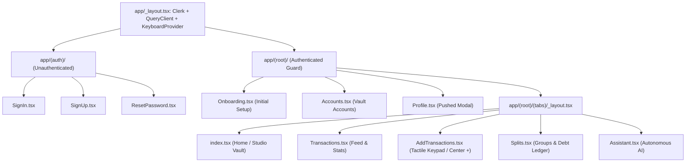

# Saldo — Product Requirements Document (PRD) & Functional Specification

| Metadata | Value |
| :--- | :--- |
| **Product Name** | Saldo |
| **Version** | 1.0.0 (Production Core Specification) |
| **Document Status** | Approved / Living Architecture Contract |
| **Target Platforms** | iOS (iPhone), Android (Mobile), Web (Responsive Tablet/Desktop) |
| **Framework** | Expo SDK 57 + React Native 0.86 + Expo Router v57 |
| **Author** | Antigravity AI Engineering & DeepMind Pair Programming |

---

## 1. Executive Summary & Vision

### 1.1 Problem Statement
Modern personal finance mobile applications suffer from three critical structural flaws:
1. **Ad-Loaded, Video-Game Aesthetics:** Apps like Mint or generic trackers use cartoonish, candy-colored gamification, popups, and credit card ads that feel cluttered and untrustworthy.
2. **Account Balances as Mutable Integers:** Most simple trackers let users directly edit balance fields in a database. When numbers don't add up, users manually fudge balances, destroying financial auditability and ledger integrity.
3. **Multiplayer Split Over-Engineering:** Services like Splitwise force every roommate or friend to create an account, download the app, and connect bank accounts, creating high friction for casual group tabs (*"I bought the coffee, you owe me 400"*).

### 1.2 Vision Statement
Saldo is a **"Solo-First" Neo-Banking and Pocket-Money Ledger**. It provides a single user with uncompromising financial oversight through:
- An **immutable append-only double-entry ledger**.
- An **autonomous AI financial assistant** capable of reading, recording, and securely deleting entries.
- A **frictionless casual split system** where the user tracks group balances without requiring friends to install the software.
- A **"Stealth Luxury" monochrome design aesthetic** where color is banished in favor of dark minimalism, reserving a single gold accent (`#C9A24B`) strictly for open debt obligations.

---

## 2. Target Audience & User Personas

### Persona A: "The Focused Professional / Student" (Solo User)
- **Age:** 20 – 35
- **Primary Pain Point:** *"Where did my monthly allowance or salary go?"*
- **Behavior:** Wants to log expenses in under 3 seconds using a physical-style tactile keypad or natural voice phrase.
- **Expectation:** Clean, dark, distraction-free interface that looks and feels like a Swiss vault terminal.

### Persona B: "The Casual Group Payer" (Flatmate / Trip Organizer)
- **Age:** 22 – 32
- **Primary Pain Point:** *"I paid the 15,000 PKR dinner bill. Who has paid me back and who still owes me?"*
- **Behavior:** Logs the bill once, assigns portions to named friends (no app invites required), and taps *"Settle"* when cash or bank transfer arrives.
- **Expectation:** Clear view of net owed balance with instant visual distinction of open debts.

---

## 3. Information Architecture & Navigation

Saldo uses **Expo Router file-based navigation** with an isolated root layout, protected application group, and a 5-slot bottom tab bar:

### Tab Bar Specification
The bottom tab bar is a floating dark bar with a raised center action button:
1. **Slot 1 (Home):** Icon `home` / `home-outline`. Main balance, cashflow metrics, daily spend pace, and non-tab drawer.
2. **Slot 2 (Transactions):** Icon `stats-chart` / `stats-chart-outline`. Historical ledger, filters, search, and reversals.
3. **Slot 3 (Center Catalyst +):** Raised electric lime icon button (`bg-[#D4F938]`). **Navigates directly to the Tactile Keypad (`AddTransactions.tsx`) in < 1 second**, fulfilling the promise of instant expense capture without dead options or interstitial modal delays.
4. **Slot 4 (Splits):** Icon `people` / `people-outline`. Groups, informal loans, person debt ledger, settlements, and directory.
5. **Slot 5 (Assistant):** Icon `sparkles` / `sparkles-outline`. Autonomous AI agent chat terminal.

---

## 4. Functional Specifications by Module

### Module 1: Authentication & User Synchronization
- **Engine:** `@clerk/expo` with Supabase JWT integration.
- **Capabilities:**
  - Email & password sign-in, sign-up with email verification code.
  - Native Google OAuth single-sign-on using Expo AuthSession (`src/shared/lib/useGoogleAuth.ts`).
  - Session tokens securely persisted in hardware-encrypted storage via `expo-secure-store`.
  - `useUserSync` automatically synchronizes Clerk authenticated identity with Supabase `profiles` table.
  - Onboarding guard checks `needsOnboarding` state flag before releasing user to tabs.

### Module 2: Append-Only Double-Entry Ledger Mechanics
- **Philosophy:** No direct balance mutation. Balance is dynamically computed by querying `balance_entries`.
- **Database Schema:**
  - `accounts`: Stores account identities (`name`, `type`, `currency`, `is_default`, `user_id`).
  - `transactions`: Stores financial events (`amount`, `type`, `category_id`, `account_id`, `transfer_account_id`, `description`, `date`, `status`).
  - `balance_entries`: Immutable ledger records (`account_id`, `delta`, `reason`, `transaction_id`, `settlement_id`).
- **Resilience Engine & Loud Failure:**
  - Database constraint and RLS policy failures throw immediate exceptions; errors are never silently swallowed to fake local success.
  - Append-only reversal mutations (`reverseTransaction`) generate equal and opposite counter-entries with automatic `balance_entries` delta, preserving full financial audit trails.

### Module 3: Home Studio Vault Dashboard (`app/(root)/(tabs)/index.tsx`)
- **Monumental Balance Display:**
  - Displays **"Available Balance"** (scoped to active account) or **"Total Balance"** (aggregated net worth across all accounts).
  - Eye icon privacy toggle (`isBalanceHidden`) switches between formatted currency and `••••••`.
  - Dynamic font size auto-scaling (`adjustsFontSizeToFit`) prevents numerical truncation.
- **Inflow / Outflow Tactile Pills:**
  - Emerald inflow pill shows current month deposits.
  - Rose outflow pill shows current month expenditures.
- **Account Switcher Modal (`AccountSwitcherModal.tsx`):**
  - Displays list of accounts with individual balances.
  - Allows selecting *"All Accounts (Consolidated Vault)"* or a specific funding account.
- **Animated Push-Down Feature Drawer (`HomeHeaderWithDrawer.tsx`):**
  - Push-down toggle for non-tab management shortcuts (*Accounts*, *Budgets*, *Categories*, *Recurring*).
  - Circular avatar button navigates **directly to `Profile.tsx`**.
  - Redundant 3-button add strip removed in favor of single primary center `+` entry point.

### Module 4: Transaction Entry Pipeline (`app/(root)/(tabs)/AddTransactions.tsx`)
- **Direct Access:** Tapping center `+` tab button routes directly to Keypad in < 1s.
- **Tactile Keypad:** 3×4 numerical grid with backspace, decimal point, and inline math evaluator (`+`, `-`, `×`, `÷`).
- **Quick-Amount Preset Chips:** Tactile chips for rapid additions (`+100`, `+500`, `+1,000`, `+5,000`).
- **Deep Split & 1-on-1 Casual Debt Integration:**
  - "Who Paid?" Selector: `You` vs `Friend`, allocating `owed_to_me` or `i_owe` direction.
  - 1-on-1 Person Picker: Direct debt recording with individual people without dummy groups.
  - Deterministic Minor-Unit Integer Split Math: `computeSplitShares` allocates remainders deterministically down to the last paisa/cent.

### Module 5: Transaction Feed & Cashflow Analytics (`app/(root)/(tabs)/Transactions.tsx`)
- **Filter Segment Tabs:** `All`, `Income`, `Expense`, `Transfer`.
- **Date Sectioning:** Groups entries into *"Today"*, *"Yesterday"*, and formatted calendar dates.
- **Detail & Reversal Modal (`TransactionDetailModal.tsx`):** Full transaction inspection with append-only **"Post Reversal"** action that creates an offsetting counter-entry while preserving ledger immutability.

### Module 6: Autonomous Financial AI Assistant (`app/(root)/(tabs)/Assistant.tsx`)
- **Architecture:** Hybrid generative agent combining Google Gemini Function Calling with a deterministic offline NLP engine.
- **Tools Declared:**
  1. `get_financial_summary`: Live net worth, account balances, monthly cashflow.
  2. `query_transactions`: Filter by category, type, date, or merchant search query.
  3. `log_transaction`: Write tool creating real transaction and balance entries.
  4. `check_budgets`: Category limits and remaining allowances.
  5. `delete_transaction`: Proposes deletion, requiring explicit user confirmation.
- **UX Polish & Keyboard Handling:**
  - Powered by `KeyboardAvoidingView` from `react-native-keyboard-controller`.
  - Synchronous native keyboard avoidance ensures input bar is never covered by the soft keyboard.
  - `keyboardShouldPersistTaps="handled"` ensures send button taps and quick prompts are never dropped.
  - Virtual keyboard Return key (`returnKeyType="send"`, `onSubmitEditing`) sends message directly.

### Module 7: Splits, Informal Loans & Direct Person Debt Engine (`app/(root)/(tabs)/Splits.tsx`)
- **Person as the Unit Paradigm (`PersonDebtCard.tsx`):**
  - Consolidates all personal tabs with a single individual into a unified card (*"Hamza K. owes you ₨ 3,400 total"*).
  - Expandable accordion exposes individual composite items (*"₨ 2,400 from Apartment 4B split, ₨ 1,000 personal loan"*).
- **Two Distinct Settlement Modes (`SettleModal.tsx`):**
  - **Mode A: Settle from Account (Ledger Movement):** Executes `balance_entries` delta against a selected bank/cash account.
  - **Mode B: Settle Off-Ledger (Mark Settled Only):** Closes debt obligation for external cash or barter without balance movement.
  - Supports partial debt settlements via 50%/100% quick chips or custom amounts, transitioning to `partially_settled`.
- **People Directory Manager (`PeopleManagerModal.tsx`):**
  - Inline contact renaming, debt inspection, and safe contact deletion (guarded against contacts with non-zero open debt).
- **Direct 1-on-1 Casual Loans (`DirectLoanModal.tsx`):**
  - Allows recording casual debts (*"I lent Ali 5,000"*, *"Cousin lent me 20,000"*) directly without creating a shared group.
  - Direction selection: *I Lent (Receivable)* vs. *I Borrowed (Liability)*.
  - Double-entry invariance: recorded as receivable asset swap or liability inflow; does not falsify income or expense budget figures.
- **Anti-Gold-Wall Rule:** Reserving solid `#C9A24B` gold strictly for overdue obligations (`due_date < today`). Active non-overdue obligations receive subtle stealth slate badges (`#161B26` / `#94A3B8`).

### Module 8: Multi-Account Management (`app/(root)/Accounts.tsx`)
- **Account Types Supported:** `cash`, `bank`, `savings`, `credit_card`, `wallet`.
- **Account Form Modal:** Create or rename accounts, select account currency, and set default account.
- **Calculated Balances:** Sums all `balance_entries` deltas specifically belonging to each account ID.

### Module 9: Budget Engine & Allowance Pacing (`app/(root)/budgets/`)
- **Pacing Metrics:** Live calculation of safe daily burn based on days remaining in month.
- **Allocation & Detail Views:** Monthly spending limits configured per category, with dedicated detail screen (`app/(root)/budgets/[id].tsx`) filtering associated transactions.

### Module 10: Profile & Global Settings (`app/(root)/Profile.tsx`)
- **Modal Presentation:** Slides up outside the tab bar; closed via top header button.
- **User Header:** Initials avatar badge, full Clerk name, primary email address.
- **Active Currency Picker:** Searchable modal powered by [`CurrencyPicker.tsx`](file:///mnt/a0d79cc5-6dd9-440b-b6fc-23c61c69d7e8/personal-projects/ReactNative/Expense-Tracker/src/shared/components/CurrencyPicker.tsx) supporting 50+ global currencies, updating base currency across all screens instantly.
- **Direct Navigation:** Links to Accounts management and Splits tab.
- **Clerk Sign Out:** Authenticated session termination with prompt confirmation.

---

## 5. Non-Functional Requirements (NFRs)

| Category | Standard | Validation Mechanism |
| :--- | :--- | :--- |
| **Performance** | 60fps UI transitions, screen render < 100ms | React Native Reanimated worklets, virtualized FlatLists |
| **Offline Resilience** | App must never crash or freeze when offline | Local in-memory caches across all service modules |
| **Data Integrity** | Balances must mathematically equal sum of deltas | Append-only `balance_entries` ledger |
| **Accessibility** | Minimum 44×44px touch targets on interactive controls | `hitSlop` bounding boxes, accessibilityRole attributes |
| **Color Contrast** | WCAG AA compliant (4.5:1 text-to-background ratio) | Slate `#E2E8F0` on `#090D16` dark canvas |
| **Keyboard UX** | Inputs must never be covered or tap-dropped | `react-native-keyboard-controller` + persistent taps |
| **Type Safety** | 0 TypeScript errors across codebase | Strict `bun x tsc --noEmit` validation |

---

## 6. Edge Cases & Resilience Matrix

| Scenario | Risk | Saldo Handling Mechanism |
| :--- | :--- | :--- |
| **Device is Offline** | Remote Supabase queries fail | Service layers fall back to optimistic local cache; data remains editable and browsable. |
| **Gemini API Key Missing / Blocked** | AI chat hangs or throws 401 | `services/ai/gemini.ts` validates key format and falls back instantly to local NLP engine (< 1s). |
| **Virtual Keyboard Appears** | Input bar covered by keyboard | `react-native-keyboard-controller` synchronously lifts input container; bottom tabs hide automatically. |
| **Negative Net Worth** | App crashes or formats incorrectly | `formatCurrency` supports negative formatting with tabular numerals and currency symbols. |
| **Accidental Deletion** | User permanently deletes ledger data | Destructive actions require explicit dialog confirmation cards (`UniversalPromptModal` / ToolActionCard). |

